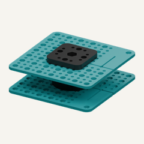
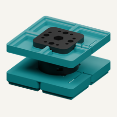
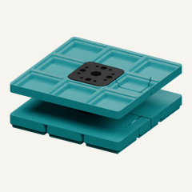

<!-- reel-catalogue:start -->
# OOBB ribbon reels

Print a reel for ribbon up to 25, 50, 75 or 100 mm wide. The original end plates use the OOBB hole grid. The two Gridfinity versions sit in a baseplate and let one reel stack on another. All three use the same winding cores and removable four-peg drive.

Based on [oomlout’s OOBB system](https://github.com/oomlout/oomlout_oobb_version_5) and [Zack Freedman’s Gridfinity](https://www.youtube.com/watch?v=ra_9zU-mnl8), using [willtree8’s dimension reference](https://gridfinity.xyz/specification/).

> This is an entirely AI-generated coding project. The source code is largely unreadable by humans, but usable generated files are included. It is published so others can use their own AI tools to understand, modify and regenerate the design.

AI-generated CAD images and instructions. Errors possible. Physical fit has yet to be confirmed on a print.

## Print and fit

[Download the named Bambu Studio plates](output/project_summary/) or [print a small interface trial](design_stages/). Each build plate contains a complete reel and one drive. The core length is the distance between the two ribbon faces. Allow winding clearance when choosing a core for ribbon of exactly that width.

[Browse printable parts](navigation_oobb/oobb/part/organize/ribbon/reel/) · [Regenerate the files](CAD_BUILDING.md#ribbon-reel-release)

## Assembly

Each guide illustrates the 25 mm core and covers all four winding widths.

| Reel | Version | Footprint | Assembly viewer | Booklet |
| --- | --- | --- | --- | --- |
|  | [Original OOBB](parts/oobb_part_organize_ribbon_reel_end_cap_7_width_7_height_3_depth/) | 104 mm square | [Offline HTML](parts/oobb_part_organize_ribbon_reel_end_cap_7_width_7_height_3_depth/assembly/assembly_instructions.html) | [PDF](parts/oobb_part_organize_ribbon_reel_end_cap_7_width_7_height_3_depth/assembly/assembly_instructions.pdf) |
|  | [Gridfinity 2 × 2](parts/oobb_part_organize_ribbon_reel_gridfinity_end_2x2_socket/) | 83.5 mm square | [Offline HTML](parts/oobb_part_organize_ribbon_reel_gridfinity_end_2x2_socket/assembly/assembly_instructions.html) | [PDF](parts/oobb_part_organize_ribbon_reel_gridfinity_end_2x2_socket/assembly/assembly_instructions.pdf) |
|  | [Gridfinity 3 × 3](parts/oobb_part_organize_ribbon_reel_gridfinity_end_3x3_socket/) | 125.5 mm square | [Offline HTML](parts/oobb_part_organize_ribbon_reel_gridfinity_end_3x3_socket/assembly/assembly_instructions.html) | [PDF](parts/oobb_part_organize_ribbon_reel_gridfinity_end_3x3_socket/assembly/assembly_instructions.pdf) |
<!-- reel-catalogue:end -->
