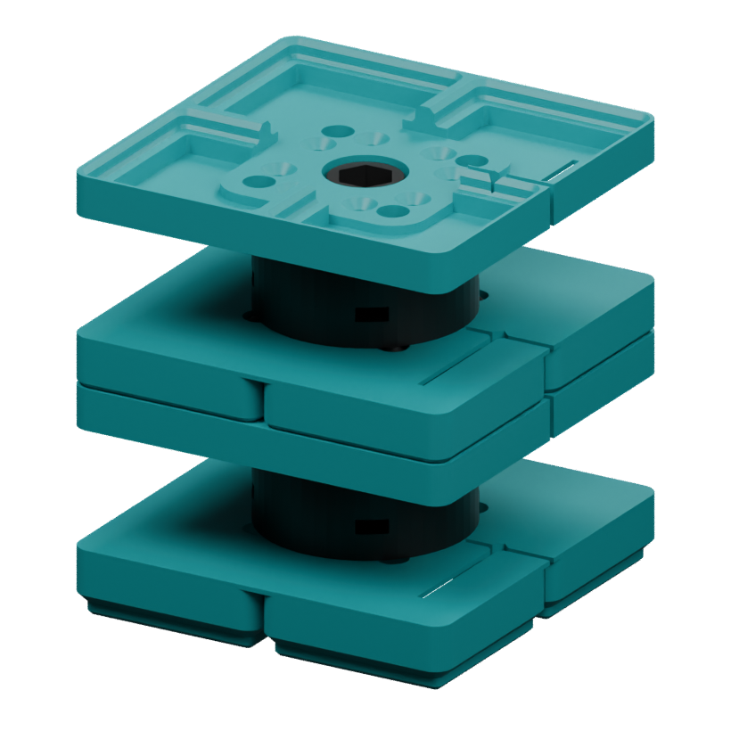
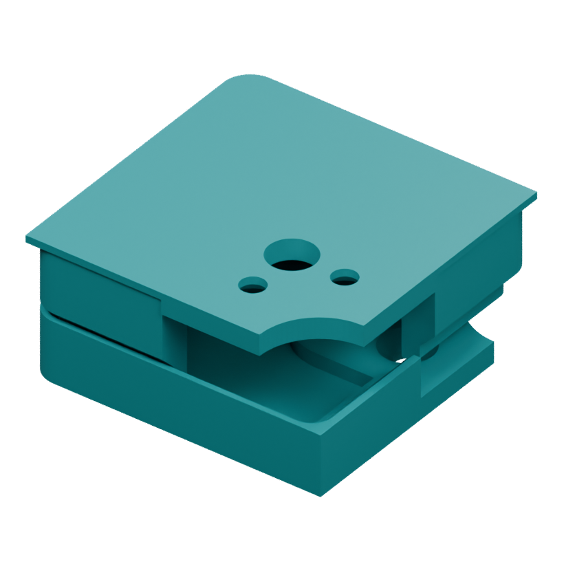

# Gridfinity fit trials

Print at 100% with the broad ribbon face on the bed. Use the same filament, nozzle, extrusion settings and first-layer compensation planned for the reel. The corner trials use one 42 mm corner of each production plate. Each pair keeps the same pitch and mating profile as the full print.

| Trial | 2 × 2 reel | 3 × 3 reel | Check |
| --- | --- | --- | --- |
| Plug corner | [STL](2x2/corner_plug.stl) | [STL](3x3/corner_plug.stl) | Seat in a Gridfinity baseplate and the matching socket coupon. |
| Socket corner | [STL](2x2/corner_socket.stl) | [STL](3x3/corner_socket.stl) | Look for contact at the bottom shoulder and lateral restraint. |
| Gear seat, plug | [STL](2x2/gear_seat_plug.stl) | [STL](3x3/gear_seat_plug.stl) | Fit the existing drive and check all four pegs and the flat seating face. |
| Gear seat, socket | [STL](2x2/gear_seat_socket.stl) | [STL](3x3/gear_seat_socket.stl) | Repeat with four M3 screws installed flush. |
| Installed drive | [OpenSCAD](2x2/gear_seated.scad) | [OpenSCAD](3x3/gear_seated.scad) | Gear shaft, peg direction and face contact. |
| Seated stack section | [OpenSCAD](2x2/stack_section.scad) | [OpenSCAD](3x3/stack_section.scad) | Inspect the stepped interfaces in section. |
| Two stacked reels | [OpenSCAD](2x2/stacked_reels.scad) | [OpenSCAD](3x3/stacked_reels.scad) | Inspect the small perimeter engagement between complete reels. |
| Exploded reel | [OpenSCAD](2x2/reel_exploded.scad) | [OpenSCAD](3x3/reel_exploded.scad) | Position of each printed piece on the reel axis. |
| Mesh checks | [JSON](2x2/fit_report.json) | [JSON](3x3/fit_report.json) | Generated boolean intersections in mm³ with the SHA-256 of each source STL. |

The journalled zero-overlap tests use the actual exported meshes. Overtravel and lateral-displacement tests intentionally produce positive overlap to demonstrate a working stop. Each size also includes independent full-foot and baseplate gauges based on [willtree8’s Gridfinity reference](https://gridfinity.xyz/specification/). The 2 × 2 and 3 × 3 reports cover same-size stacks in four rotations. Lift the detachable drives off the mating faces before stacking.

Both plates have a 1.0 mm ribbon web. The lower feet add the standard 4.75 mm Gridfinity profile (5.75 mm overall). The upper perimeter lip rises just 1.6 mm (2.6 mm overall). The feet bottom on the flat web. The ribbon faces are 6.75 mm apart across a seated joint. At the outer edge, a 5 mm diamond mouth tapers into the 1.5 mm slit. The smaller diamond at the retaining branch is also present.

The drive sits on the exposed surface and engages four 6.5 mm bores on 30 mm centres. A 17 mm through-hole clears the 15 mm shaft. On the rim side the pegs pass through the thin web into 2.2 mm reliefs on the revised winding core. Use the current core STL for these plates. All four winding depths use the same ends and the same eight M3 × 12 countersunk screws.

The physical fit, retention under load and wear still need a printed trial. The hardware reference meshes in this folder are digital gauges for purchased hardware.
