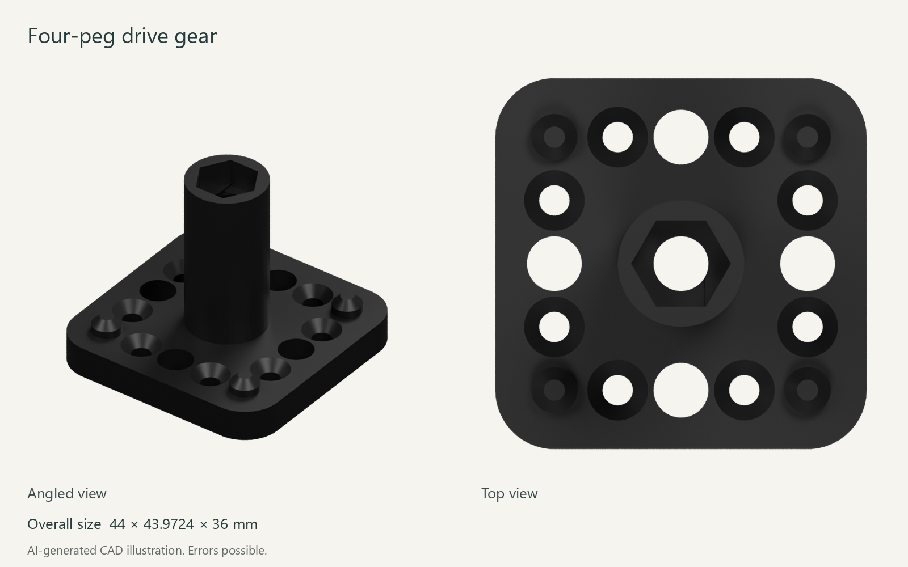

<!-- reel-catalogue:start -->
# Four-peg drive gear

> AI-generated CAD images and instructions. Errors possible.

## Summary

A removable drive with a 44 mm face, a 15 mm shaft and four tapered locating pegs.

[](./)

## Details

[Printable STL](3dpr.stl) · [OpenSCAD source](3dpr.scad) · [Part folder](./) · [OOBB navigation](../../navigation_oobb/oobb/part/organize/ribbon/reel/drive_gear/3_width/3_height/6_depth/)

## Parts

`oobb_part_organize_ribbon_reel_drive_gear_3_width_3_height_6_depth`

<details><summary>Catalogue metadata</summary>

```yaml
bip_39_2_word_array:
- utility
- bronze
bip_39_2_word_no_space: utilitybronze
bip_39_2_word_space: utility bronze
bip_39_2_word_underscore: utility_bronze
bip_39_3_word_array:
- utility
- bronze
- excite
bip_39_3_word_no_space: utilitybronzeexcite
bip_39_3_word_space: utility bronze excite
bip_39_3_word_underscore: utility_bronze_excite
bip_39_full_array:
- utility
- bronze
- excite
- tuna
- wheel
- acquire
- clever
- hire
- curious
- trouble
- glass
- option
bip_39_full_no_space: utilitybronzeexcitetunawheelacquirecleverhirecurioustroubleglassoption
bip_39_full_space: utility bronze excite tuna wheel acquire clever hire curious trouble
  glass option
bip_39_full_underscore: utility_bronze_excite_tuna_wheel_acquire_clever_hire_curious_trouble_glass_option
depth: 6
directory: parts/oobb_part_organize_ribbon_reel_drive_gear_3_width_3_height_6_depth
height: 3
id: oobb_part_organize_ribbon_reel_drive_gear_3_width_3_height_6_depth
id_no_class: oobb_part_organize_ribbon_reel_drive_gear_3_width_3_height_6_depth
id_no_size: oobb_part_organize_ribbon_reel_drive_gear_3_width_3_height_6_depth
id_no_type: oobb_part_organize_ribbon_reel_drive_gear_3_width_3_height_6_depth
link_github: https://github.com/oomlout/oomlout_oomp_version_1_messy/tree/main/parts/oobb_part_organize_ribbon_reel_drive_gear_3_width_3_height_6_depth
link_main: https://github.com/oomlout/oomlout_oomp_version_1_messy/tree/main/parts/oobb_part_organize_ribbon_reel_drive_gear_3_width_3_height_6_depth
link_redirect: https://github.com/oomlout/oomlout_oomp_version_1_messy/tree/main/parts/oobb_part_organize_ribbon_reel_drive_gear_3_width_3_height_6_depth
md5: f043953b753fa0044aa36035fd218bcd
md5_10: f043953b75
md5_10_upper: F043953B75
md5_5: f0439
md5_5_upper: F0439
md5_6: f04395
md5_6_alpha: 9dhn9
md5_6_alpha_upper: 9DHN9
md5_6_upper: F04395
name: Oobb Part Organize Ribbon Reel Drive Gear 3 Width 3 Height 6 Depth
name_no_class: Oobb Part Organize Ribbon Reel Drive Gear 3 Width 3 Height 6 Depth
name_no_size: Oobb Part Organize Ribbon Reel Drive Gear 3 Width 3 Height 6 Depth
name_no_type: Oobb Part Organize Ribbon Reel Drive Gear 3 Width 3 Height 6 Depth
name_proper: Oobb Part Organize Ribbon Reel Drive Gear 3 Width 3 Height 6 Depth
name_space: oobb part organize ribbon reel drive gear 3 width 3 height 6 depth
name_upper: OOBB PART ORGANIZE RIBBON REEL DRIVE GEAR 3 WIDTH 3 HEIGHT 6 DEPTH
oobb_details:
  depth: 6
  height: 3
  oobb_type: drive_gear
  run_scad: true
  run_solidcraft: false
  shaft_diameter: 15
  shaft_length: 30
  taxonomy_1: oobb
  taxonomy_2: part
  taxonomy_3: organize
  taxonomy_4: ribbon
  taxonomy_5: reel
  taxonomy_6: drive_gear
  taxonomy_7: 3_width
  taxonomy_8: 3_height
  taxonomy_9: 6_depth
  width: 3
oobb_type: drive_gear
oomlout_ai_roboclick_1:
  action_name: step_0_jinja_template_label_oomp.svg
  actions:
  - command: text_jinja_template
    convert_to_pdf: false
    convert_to_png: false
    dict_data:
      depth: 6
      directory: parts\oobb_part_organize_ribbon_reel_drive_gear_3_width_3_height_6_depth
      height: 3
      name: oobb_part_organize_ribbon_reel_drive_gear_3_width_3_height_6_depth
      name_proper: Oobb Part Organize Ribbon Reel Drive Gear 3 Width 3 Height 6 Depth
      name_space: oobb part organize ribbon reel drive gear 3 width 3 height 6 depth
      name_upper: OOBB PART ORGANIZE RIBBON REEL DRIVE GEAR 3 WIDTH 3 HEIGHT 6 DEPTH
      oobb_details:
        depth: 6
        height: 3
        oobb_type: drive_gear
        run_scad: true
        run_solidcraft: false
        shaft_diameter: 15
        shaft_length: 30
        taxonomy_1: oobb
        taxonomy_2: part
        taxonomy_3: organize
        taxonomy_4: ribbon
        taxonomy_5: reel
        taxonomy_6: drive_gear
        taxonomy_7: 3_width
        taxonomy_8: 3_height
        taxonomy_9: 6_depth
        width: 3
      oobb_type: drive_gear
      shaft_diameter: 15
      shaft_length: 30
      taxonomy_1: oobb
      taxonomy_10: ''
      taxonomy_11: ''
      taxonomy_12: ''
      taxonomy_13: ''
      taxonomy_14: ''
      taxonomy_15: ''
      taxonomy_2: part
      taxonomy_3: organize
      taxonomy_4: ribbon
      taxonomy_5: reel
      taxonomy_6: drive_gear
      taxonomy_7: 3_width
      taxonomy_8: 3_height
      taxonomy_9: 6_depth
      url_chat: ''
      width: 3
    dict_data_files: {}
    dict_data_files_exists: {}
    file_output: label_oomp.svg
    file_template: C:\gh\oomlout_oobb_part_organize_ribbon_reel_version_5\source_file\template_jinja\template_jinja_label_oomlout_76_2_mm_50_8_mm\working.svg.j2
    search_and_replace: []
  file_test: label_oomp.pdf
  retries_until_complete: 0
oomp_key: oomp_oobb_part_organize_ribbon_reel_drive_gear_3_width_3_height_6_depth
shaft_diameter: 15
shaft_length: 30
taxonomy_1: oobb
taxonomy_10: ''
taxonomy_11: ''
taxonomy_12: ''
taxonomy_13: ''
taxonomy_14: ''
taxonomy_15: ''
taxonomy_1_capital: Oobb
taxonomy_1_first_letter: o
taxonomy_1_first_letter_upper: O
taxonomy_1_length_1: o
taxonomy_1_length_2: oo
taxonomy_1_length_3: oob
taxonomy_1_length_4: oobb
taxonomy_1_length_5: oobb
taxonomy_1_upper: OOBB
taxonomy_1_upper_length_1: O
taxonomy_1_upper_length_2: OO
taxonomy_1_upper_length_3: OOB
taxonomy_1_upper_length_4: OOBB
taxonomy_1_upper_length_5: OOBB
taxonomy_2: part
taxonomy_2_capital: Part
taxonomy_2_first_letter: p
taxonomy_2_first_letter_upper: P
taxonomy_2_length_1: p
taxonomy_2_length_2: pa
taxonomy_2_length_3: par
taxonomy_2_length_4: part
taxonomy_2_length_5: part
taxonomy_2_upper: PART
taxonomy_2_upper_length_1: P
taxonomy_2_upper_length_2: PA
taxonomy_2_upper_length_3: PAR
taxonomy_2_upper_length_4: PART
taxonomy_2_upper_length_5: PART
taxonomy_3: organize
taxonomy_3_capital: Organize
taxonomy_3_first_letter: o
taxonomy_3_first_letter_upper: O
taxonomy_3_length_1: o
taxonomy_3_length_2: or
taxonomy_3_length_3: org
taxonomy_3_length_4: orga
taxonomy_3_length_5: organ
taxonomy_3_upper: ORGANIZE
taxonomy_3_upper_length_1: O
taxonomy_3_upper_length_2: OR
taxonomy_3_upper_length_3: ORG
taxonomy_3_upper_length_4: ORGA
taxonomy_3_upper_length_5: ORGAN
taxonomy_4: ribbon
taxonomy_4_capital: Ribbon
taxonomy_4_first_letter: r
taxonomy_4_first_letter_upper: R
taxonomy_4_length_1: r
taxonomy_4_length_2: ri
taxonomy_4_length_3: rib
taxonomy_4_length_4: ribb
taxonomy_4_length_5: ribbo
taxonomy_4_upper: RIBBON
taxonomy_4_upper_length_1: R
taxonomy_4_upper_length_2: RI
taxonomy_4_upper_length_3: RIB
taxonomy_4_upper_length_4: RIBB
taxonomy_4_upper_length_5: RIBBO
taxonomy_5: reel
taxonomy_5_capital: Reel
taxonomy_5_first_letter: r
taxonomy_5_first_letter_upper: R
taxonomy_5_length_1: r
taxonomy_5_length_2: re
taxonomy_5_length_3: ree
taxonomy_5_length_4: reel
taxonomy_5_length_5: reel
taxonomy_5_upper: REEL
taxonomy_5_upper_length_1: R
taxonomy_5_upper_length_2: RE
taxonomy_5_upper_length_3: REE
taxonomy_5_upper_length_4: REEL
taxonomy_5_upper_length_5: REEL
taxonomy_6: drive_gear
taxonomy_6_capital: Drive Gear
taxonomy_6_first_letter: d
taxonomy_6_first_letter_upper: D
taxonomy_6_length_1: d
taxonomy_6_length_2: dr
taxonomy_6_length_3: dri
taxonomy_6_length_4: driv
taxonomy_6_length_5: drive
taxonomy_6_upper: DRIVE_GEAR
taxonomy_6_upper_length_1: D
taxonomy_6_upper_length_2: DR
taxonomy_6_upper_length_3: DRI
taxonomy_6_upper_length_4: DRIV
taxonomy_6_upper_length_5: DRIVE
taxonomy_7: 3_width
taxonomy_7_capital: 3 Width
taxonomy_7_first_letter: '3'
taxonomy_7_first_letter_upper: '3'
taxonomy_7_length_1: '3'
taxonomy_7_length_2: '3_'
taxonomy_7_length_3: 3_w
taxonomy_7_length_4: 3_wi
taxonomy_7_length_5: 3_wid
taxonomy_7_upper: 3_WIDTH
taxonomy_7_upper_length_1: '3'
taxonomy_7_upper_length_2: '3_'
taxonomy_7_upper_length_3: 3_W
taxonomy_7_upper_length_4: 3_WI
taxonomy_7_upper_length_5: 3_WID
taxonomy_8: 3_height
taxonomy_8_capital: 3 Height
taxonomy_8_first_letter: '3'
taxonomy_8_first_letter_upper: '3'
taxonomy_8_length_1: '3'
taxonomy_8_length_2: '3_'
taxonomy_8_length_3: 3_h
taxonomy_8_length_4: 3_he
taxonomy_8_length_5: 3_hei
taxonomy_8_upper: 3_HEIGHT
taxonomy_8_upper_length_1: '3'
taxonomy_8_upper_length_2: '3_'
taxonomy_8_upper_length_3: 3_H
taxonomy_8_upper_length_4: 3_HE
taxonomy_8_upper_length_5: 3_HEI
taxonomy_9: 6_depth
taxonomy_9_capital: 6 Depth
taxonomy_9_first_letter: '6'
taxonomy_9_first_letter_upper: '6'
taxonomy_9_length_1: '6'
taxonomy_9_length_2: '6_'
taxonomy_9_length_3: 6_d
taxonomy_9_length_4: 6_de
taxonomy_9_length_5: 6_dep
taxonomy_9_upper: 6_DEPTH
taxonomy_9_upper_length_1: '6'
taxonomy_9_upper_length_2: '6_'
taxonomy_9_upper_length_3: 6_D
taxonomy_9_upper_length_4: 6_DE
taxonomy_9_upper_length_5: 6_DEP
url_chat: ''
width: 3
```

</details>

## Assembly

[Open the reel assembly guide](../oobb_part_organize_ribbon_reel_end_cap_7_width_7_height_3_depth/#assembly).
<!-- reel-catalogue:end -->
