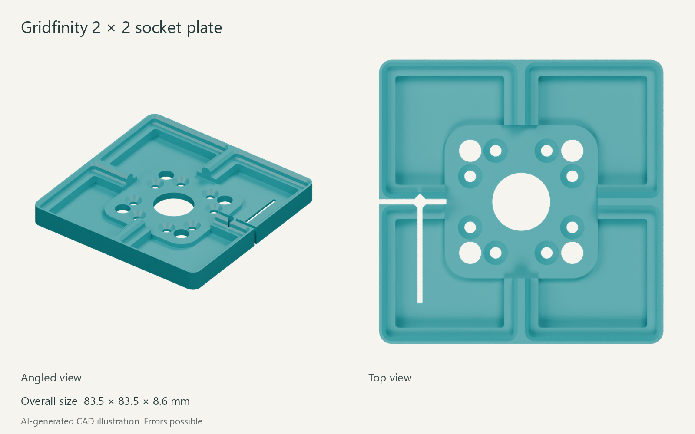
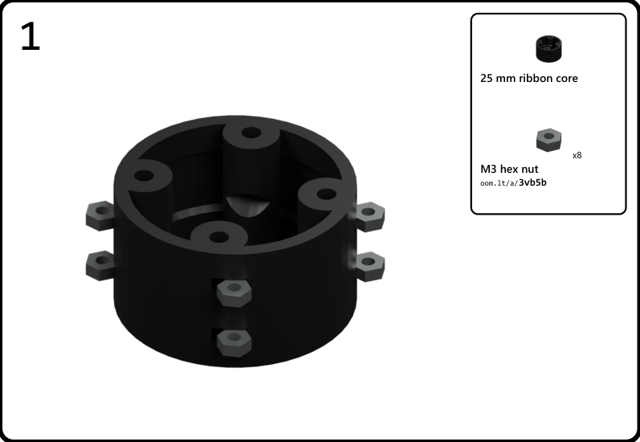
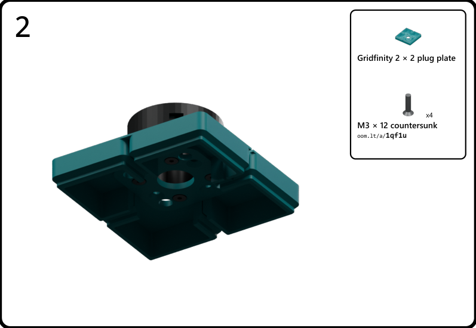
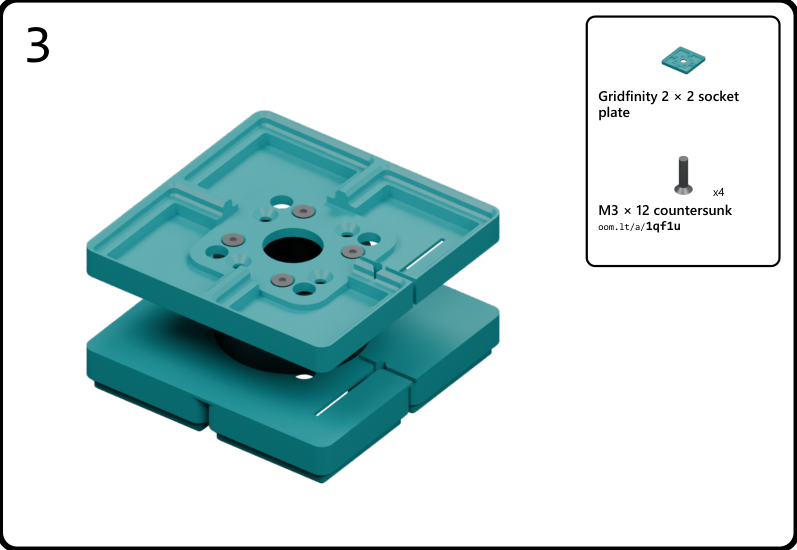
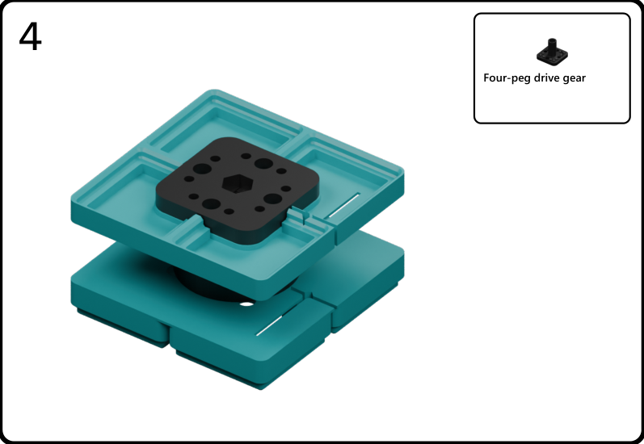

<!-- reel-catalogue:start -->
# Gridfinity 2 × 2 socket plate

> AI-generated CAD images and instructions. Errors possible.

## Summary

Gridfinity 2 × 2 socket plate for a 83.5 mm square ribbon reel on a 42 mm pitch. Print ribbon face down.

[](./)

## Details

[Printable STL](3dpr.stl) · [OpenSCAD source](3dpr.scad) · [Part folder](./) · [OOBB navigation](../../navigation_oobb/oobb/part/organize/ribbon/reel/gridfinity_end/2x2/socket/)

## Parts

`oobb_part_organize_ribbon_reel_gridfinity_end_2x2_socket`

<details><summary>Catalogue metadata</summary>

```yaml
bip_39_2_word_array:
- onion
- entry
bip_39_2_word_no_space: onionentry
bip_39_2_word_space: onion entry
bip_39_2_word_underscore: onion_entry
bip_39_3_word_array:
- onion
- entry
- drip
bip_39_3_word_no_space: onionentrydrip
bip_39_3_word_space: onion entry drip
bip_39_3_word_underscore: onion_entry_drip
bip_39_full_array:
- onion
- entry
- drip
- cement
- you
- cabbage
- shy
- magic
- warm
- fox
- olympic
- exclude
bip_39_full_no_space: onionentrydripcementyoucabbageshymagicwarmfoxolympicexclude
bip_39_full_space: onion entry drip cement you cabbage shy magic warm fox olympic
  exclude
bip_39_full_underscore: onion_entry_drip_cement_you_cabbage_shy_magic_warm_fox_olympic_exclude
cells: 2
directory: parts/oobb_part_organize_ribbon_reel_gridfinity_end_2x2_socket
id: oobb_part_organize_ribbon_reel_gridfinity_end_2x2_socket
id_no_class: oobb_part_organize_ribbon_reel_gridfinity_end_2x2_socket
id_no_size: oobb_part_organize_ribbon_reel_gridfinity_end_2x2_socket
id_no_type: oobb_part_organize_ribbon_reel_gridfinity_end_2x2_socket
link_github: https://github.com/oomlout/oomlout_oomp_version_1_messy/tree/main/parts/oobb_part_organize_ribbon_reel_gridfinity_end_2x2_socket
link_main: https://github.com/oomlout/oomlout_oomp_version_1_messy/tree/main/parts/oobb_part_organize_ribbon_reel_gridfinity_end_2x2_socket
link_redirect: https://github.com/oomlout/oomlout_oomp_version_1_messy/tree/main/parts/oobb_part_organize_ribbon_reel_gridfinity_end_2x2_socket
md5: 9ac9750c929ff23f71e42ef72b8a6927
md5_10: 9ac9750c92
md5_10_upper: 9AC9750C92
md5_5: 9ac97
md5_5_upper: 9AC97
md5_6: 9ac975
md5_6_alpha: 61f91
md5_6_alpha_upper: 61F91
md5_6_upper: 9AC975
name: Oobb Part Organize Ribbon Reel Gridfinity End 2X2 Socket
name_no_class: Oobb Part Organize Ribbon Reel Gridfinity End 2X2 Socket
name_no_size: Oobb Part Organize Ribbon Reel Gridfinity End 2X2 Socket
name_no_type: Oobb Part Organize Ribbon Reel Gridfinity End 2X2 Socket
name_proper: Oobb Part Organize Ribbon Reel Gridfinity End 2X2 Socket
name_space: oobb part organize ribbon reel gridfinity end 2x2 socket
name_upper: OOBB PART ORGANIZE RIBBON REEL GRIDFINITY END 2X2 SOCKET
oobb_details:
  cells: 2
  oobb_type: gridfinity_end
  run_scad: true
  run_solidcraft: false
  side: socket
  taxonomy_1: oobb
  taxonomy_2: part
  taxonomy_3: organize
  taxonomy_4: ribbon
  taxonomy_5: reel
  taxonomy_6: gridfinity_end
  taxonomy_7: 2x2
  taxonomy_8: socket
  web: 1.0
oobb_type: gridfinity_end
oomlout_ai_roboclick_1:
  action_name: step_0_jinja_template_label_oomp.svg
  actions:
  - command: text_jinja_template
    convert_to_pdf: false
    convert_to_png: false
    dict_data:
      cells: 2
      directory: parts\oobb_part_organize_ribbon_reel_gridfinity_end_2x2_socket
      name: oobb_part_organize_ribbon_reel_gridfinity_end_2x2_socket
      name_proper: Oobb Part Organize Ribbon Reel Gridfinity End 2X2 Socket
      name_space: oobb part organize ribbon reel gridfinity end 2x2 socket
      name_upper: OOBB PART ORGANIZE RIBBON REEL GRIDFINITY END 2X2 SOCKET
      oobb_details:
        cells: 2
        oobb_type: gridfinity_end
        run_scad: true
        run_solidcraft: false
        side: socket
        taxonomy_1: oobb
        taxonomy_2: part
        taxonomy_3: organize
        taxonomy_4: ribbon
        taxonomy_5: reel
        taxonomy_6: gridfinity_end
        taxonomy_7: 2x2
        taxonomy_8: socket
        web: 1.0
      oobb_type: gridfinity_end
      side: socket
      taxonomy_1: oobb
      taxonomy_10: ''
      taxonomy_11: ''
      taxonomy_12: ''
      taxonomy_13: ''
      taxonomy_14: ''
      taxonomy_15: ''
      taxonomy_2: part
      taxonomy_3: organize
      taxonomy_4: ribbon
      taxonomy_5: reel
      taxonomy_6: gridfinity_end
      taxonomy_7: 2x2
      taxonomy_8: socket
      taxonomy_9: ''
      url_chat: ''
      web: 1.0
    dict_data_files: {}
    dict_data_files_exists: {}
    file_output: label_oomp.svg
    file_template: C:\gh\oomlout_oobb_part_organize_ribbon_reel_version_5\source_file\template_jinja\template_jinja_label_oomlout_76_2_mm_50_8_mm\working.svg.j2
    search_and_replace: []
  file_test: label_oomp.pdf
  retries_until_complete: 0
oomp_key: oomp_oobb_part_organize_ribbon_reel_gridfinity_end_2x2_socket
side: socket
taxonomy_1: oobb
taxonomy_10: ''
taxonomy_11: ''
taxonomy_12: ''
taxonomy_13: ''
taxonomy_14: ''
taxonomy_15: ''
taxonomy_1_capital: Oobb
taxonomy_1_first_letter: o
taxonomy_1_first_letter_upper: O
taxonomy_1_length_1: o
taxonomy_1_length_2: oo
taxonomy_1_length_3: oob
taxonomy_1_length_4: oobb
taxonomy_1_length_5: oobb
taxonomy_1_upper: OOBB
taxonomy_1_upper_length_1: O
taxonomy_1_upper_length_2: OO
taxonomy_1_upper_length_3: OOB
taxonomy_1_upper_length_4: OOBB
taxonomy_1_upper_length_5: OOBB
taxonomy_2: part
taxonomy_2_capital: Part
taxonomy_2_first_letter: p
taxonomy_2_first_letter_upper: P
taxonomy_2_length_1: p
taxonomy_2_length_2: pa
taxonomy_2_length_3: par
taxonomy_2_length_4: part
taxonomy_2_length_5: part
taxonomy_2_upper: PART
taxonomy_2_upper_length_1: P
taxonomy_2_upper_length_2: PA
taxonomy_2_upper_length_3: PAR
taxonomy_2_upper_length_4: PART
taxonomy_2_upper_length_5: PART
taxonomy_3: organize
taxonomy_3_capital: Organize
taxonomy_3_first_letter: o
taxonomy_3_first_letter_upper: O
taxonomy_3_length_1: o
taxonomy_3_length_2: or
taxonomy_3_length_3: org
taxonomy_3_length_4: orga
taxonomy_3_length_5: organ
taxonomy_3_upper: ORGANIZE
taxonomy_3_upper_length_1: O
taxonomy_3_upper_length_2: OR
taxonomy_3_upper_length_3: ORG
taxonomy_3_upper_length_4: ORGA
taxonomy_3_upper_length_5: ORGAN
taxonomy_4: ribbon
taxonomy_4_capital: Ribbon
taxonomy_4_first_letter: r
taxonomy_4_first_letter_upper: R
taxonomy_4_length_1: r
taxonomy_4_length_2: ri
taxonomy_4_length_3: rib
taxonomy_4_length_4: ribb
taxonomy_4_length_5: ribbo
taxonomy_4_upper: RIBBON
taxonomy_4_upper_length_1: R
taxonomy_4_upper_length_2: RI
taxonomy_4_upper_length_3: RIB
taxonomy_4_upper_length_4: RIBB
taxonomy_4_upper_length_5: RIBBO
taxonomy_5: reel
taxonomy_5_capital: Reel
taxonomy_5_first_letter: r
taxonomy_5_first_letter_upper: R
taxonomy_5_length_1: r
taxonomy_5_length_2: re
taxonomy_5_length_3: ree
taxonomy_5_length_4: reel
taxonomy_5_length_5: reel
taxonomy_5_upper: REEL
taxonomy_5_upper_length_1: R
taxonomy_5_upper_length_2: RE
taxonomy_5_upper_length_3: REE
taxonomy_5_upper_length_4: REEL
taxonomy_5_upper_length_5: REEL
taxonomy_6: gridfinity_end
taxonomy_6_capital: Gridfinity End
taxonomy_6_first_letter: g
taxonomy_6_first_letter_upper: G
taxonomy_6_length_1: g
taxonomy_6_length_2: gr
taxonomy_6_length_3: gri
taxonomy_6_length_4: grid
taxonomy_6_length_5: gridf
taxonomy_6_upper: GRIDFINITY_END
taxonomy_6_upper_length_1: G
taxonomy_6_upper_length_2: GR
taxonomy_6_upper_length_3: GRI
taxonomy_6_upper_length_4: GRID
taxonomy_6_upper_length_5: GRIDF
taxonomy_7: 2x2
taxonomy_7_capital: 2X2
taxonomy_7_first_letter: '2'
taxonomy_7_first_letter_upper: '2'
taxonomy_7_length_1: '2'
taxonomy_7_length_2: 2x
taxonomy_7_length_3: 2x2
taxonomy_7_length_4: 2x2
taxonomy_7_length_5: 2x2
taxonomy_7_upper: 2X2
taxonomy_7_upper_length_1: '2'
taxonomy_7_upper_length_2: 2X
taxonomy_7_upper_length_3: 2X2
taxonomy_7_upper_length_4: 2X2
taxonomy_7_upper_length_5: 2X2
taxonomy_8: socket
taxonomy_8_capital: Socket
taxonomy_8_first_letter: s
taxonomy_8_first_letter_upper: S
taxonomy_8_length_1: s
taxonomy_8_length_2: so
taxonomy_8_length_3: soc
taxonomy_8_length_4: sock
taxonomy_8_length_5: socke
taxonomy_8_upper: SOCKET
taxonomy_8_upper_length_1: S
taxonomy_8_upper_length_2: SO
taxonomy_8_upper_length_3: SOC
taxonomy_8_upper_length_4: SOCK
taxonomy_8_upper_length_5: SOCKE
taxonomy_9: ''
url_chat: ''
web: 1.0
```

</details>

## Assembly

Use one [plug plate](../oobb_part_organize_ribbon_reel_gridfinity_end_2x2_plug/) and this socket plate. The 1 mm web faces the ribbon. The rounded 45 mm square recess leaves 0.5 mm per side around the drive. The four 6.5 mm bores sit on 30 mm centres. Align plug to socket before stacking. [Fit trials and measured checks](../../design_stages/2x2/)

Eight [M3 hex nuts](https://oom.lt/a/3vb5b) and eight [M3 × 12 countersunk screws](https://oom.lt/a/1qf1u) per reel.

[Offline page viewer](assembly/assembly_instructions.html) · [Printable booklet](assembly/assembly_instructions.pdf)

1. Slide four M3 hex nuts into each end of the core.

   [](assembly/cards/step_01.png)

2. Seat the first plate against the core. Tighten four M3 × 12 countersunk screws in the matching holes.

   [](assembly/cards/step_02.png)

3. Turn the assembly over. Install the second plate with four screws. Keep both countersunk faces outward.

   [](assembly/cards/step_03.png)

4. Slide the gear shaft into the centre. Rotate to align its four pegs and press the gear face flat.

   [](assembly/cards/step_04.png)
<!-- reel-catalogue:end -->
